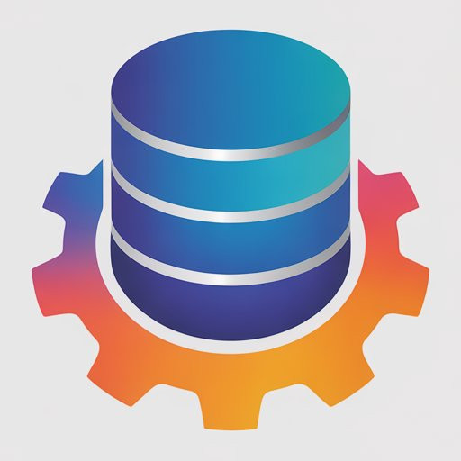

# ohCRUD



ohCRUD is a lightweight PHP framework for building database-backed websites, internal tools, and APIs. It combines explicit controller routing, PDO CRUD helpers, session authentication, a Markdown CMS, and a database administration interface in a small, readable codebase.

## What you can build

- JSON endpoints with declared HTTP methods and permission thresholds.
- SQLite or MySQL/MariaDB applications with custom models and versioned migrations.
- Websites with database pages, PHP views, reusable components, and HTML themes.
- Administrative tools for content, tables, users, uploads, and logs.
- Authenticated applications with passwords, API tokens, and optional TOTP.

Models use SQL and fluent helpers; relationships, business validation, and application services stay explicit. There is no generated ORM, middleware pipeline, or plugin registry.

## Start here

**[Install and configure ohCRUD](docs/getting-started.md)**, then **[build a feature in five minutes](docs/quickstart.md)**. The quickstart adds a public greeting API and a rendered CMS page.

The locked dependencies require **PHP 8.1 or newer**; the included development container uses PHP 8.5. You also need Composer and a supported PDO driver. See the installation guide for the complete extension and filesystem requirements.

After configuration, from the repository root:

```sh
composer --working-dir=public install
composer --working-dir=public check-platform-reqs
php private/migrate.php
```

Open `/login/` after explicitly [creating your first administrator](docs/getting-started.md#create-the-first-administrator). No default account is installed.

## Documentation

| Guide | What you will learn |
| --- | --- |
| [Documentation index](docs/DOCUMENTATION.md) | Reading paths, project map, and API references |
| [Getting started](docs/getting-started.md) | Local PHP, Docker Compose, configuration, and first login |
| [Five-minute quickstart](docs/quickstart.md) | A working endpoint and page |
| [Architecture](docs/architecture.md) | Bootstrap, request lifecycle, inheritance, and extension points |
| [Routing](docs/Router.md) | Endpoint attributes, request bodies, HTTP methods, and access policy |
| [Models and controllers](docs/models-and-controllers.md) | Schema, CRUD, validation, joins, transactions, and responses |
| [Database reference](docs/DB.md) | Method signatures and return contracts |
| [Migrations](docs/Migrations.md) | Provisioning, ordered changes, and recovery |
| [CMS and admin](docs/cms-and-admin.md) | Publishing, content schemas, media, and administration |
| [Admin API reference](docs/Admin.md) | Endpoint paths and payload fields |
| [Components](docs/components.md) | Reusable PHP views, parameters, and assets |
| [Themes](docs/Themes.md) | Layouts, placeholders, and asset processing |
| [Authentication](docs/Users.md) | Sessions, permissions, tokens, and authenticator management |
| [Core reference](docs/Core.md) | Output, errors, logging, sessions, and caching |
| [Deployment and testing](docs/deployment-and-testing.md) | Release procedure, regression suites, and troubleshooting |

## Contributing

Read the [repository instructions](AGENTS.md) and [coding style guide](docs/STYLE_GUIDE.md). Keep changes focused, document public behavior, and run the [appropriate validation](docs/deployment-and-testing.md#validation).

## License

[MIT](LICENSE).
