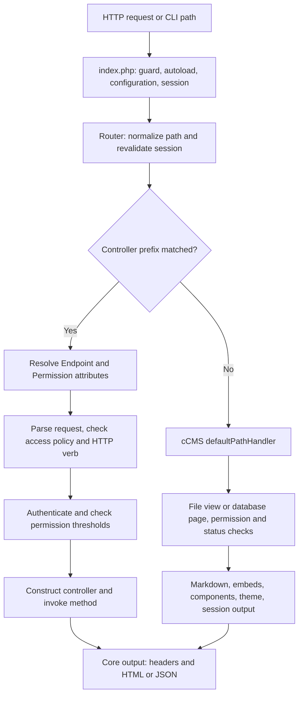

# Framework architecture

[Documentation](DOCUMENTATION.md) · Previous: [quickstart](quickstart.md) · Next: [models and controllers](models-and-controllers.md)

## Request lifecycle



[The bootstrap](../public/index.php) sets the `OHCRUD` guard and public-permission constant, loads Composer, checks the secret, configures the session cookie, and releases the session lock. Composer loads settings and routes before class dispatch. The router derives a trailing-slash path and checks an existing authenticated session against current account state.

API policy is resolved before controller construction. Only explicitly annotated public instance methods can run. An unknown method under a known prefix returns 404; it does not fall back to a CMS page. An unmatched prefix goes to the configured default handler. The API access-policy stages do not wrap the CMS fallback; CMS authorization is implemented by its own page and admin checks.

Handlers populate inherited response state and call `output()`. The router does not automatically serialize a returned value. `error()` records failure, and `output()` prints a response; neither terminates PHP. Return immediately when a failure must stop processing.

## Class responsibilities

| Type | Inheritance and role |
| --- | --- |
| `Core` | Response state, output, sessions, CSRF, logging, cache, utility methods |
| `DB extends Core` | A configured PDO connection and fluent SQL/CRUD helpers |
| `Users extends DB` | Password/token authentication, TOTP, account session validation |
| `Router extends Core` | Dispatch, endpoint reflection, access checks |
| `mPages`, `mFiles` | DB-backed schema initialization and domain constants |
| `mContent` | Plain rendering data object; no database inheritance |
| `cPages extends mPages`, `cFiles extends mFiles` | Endpoint logic atop the corresponding model |
| `cCMS extends mPages` | Content resolution and rendering |
| `Component extends DB` | Reusable rendering class with request, variables, and assets |
| `Migrations` | CLI-only migration orchestration over a supplied PDO connection |

Controllers may extend `Core` when no database is needed. Extending a model is the established way to reuse query methods. Prefer private/protected service properties: JSON output serializes object state, so public properties are not a safe place for credentials or service objects.

## Request and response contracts

- Web query/form fields appear on `$request`; JSON object bodies appear on `$request->payload` for API routes.
- CLI query strings become top-level request properties. CLI does not decode an HTTP JSON body.
- DB reads store arrays of row objects in `$data`; `first()` returns one object or `false`.
- JSON output is a state envelope, not just `$data`. Consumers should inspect HTTP status, `success`, `errors`, and `data`.
- CMS rendering separates source text from generated HTML in `mContent`. File templates and components run trusted PHP; database Markdown is purified.

Details: [Router](Router.md), [Core](Core.md), [DB](DB.md).

## Extending the framework

There is no service container, event dispatcher, middleware stack, plugin installer, relationship mapper, or scaffold generator. Use ordinary autoloaded PHP classes and explicit calls. For example, create `public/app/services/TitleFormatter.php`:

```php
<?php
namespace app\services;

// Prevent direct access to this class.
if (isset($GLOBALS['OHCRUD']) == false) { die(); }

// Normalize a title before the controller persists it.
class TitleFormatter {

    // Keep application formatting rules in one place.
    public function format($title) {
        return trim($title);
    }
}
```

Inside a controller, after validating that the title is a string:

```php
$formatter = new \app\services\TitleFormatter();
$title = $formatter->format($request->payload->TITLE);
```

For shared authorization, use a base controller with a `Permission` attribute and explicit validation helpers. For post-write behavior, call a service only after checking write success (and after committing any transaction). No automatic model events run. Introduce a durable queue explicitly if delivery/retries matter; `Core::background()` is a detached CLI convenience without persistence or retries.

To replace CMS fallback behavior, register your class as `__OHCRUD_DEFAULT_PATH_HANDLER__`. The router constructs it with `$request` and calls `defaultPathHandler($path)` if present. Keep route normalization, response generation, and authorization explicit. Most `cCMS` rendering methods are private; subclassing does not provide an overridable template-method API for them.

## Source-of-truth boundaries

The database helper is not an ORM: it does not enforce field-level business rules or ownership. The admin is a broad database-administration interface, not a tenant-safe application back office. Uploaded paths are public assets, not private downloads. Design application policies around these actual boundaries; see [authentication](Users.md) and [deployment](deployment-and-testing.md).
